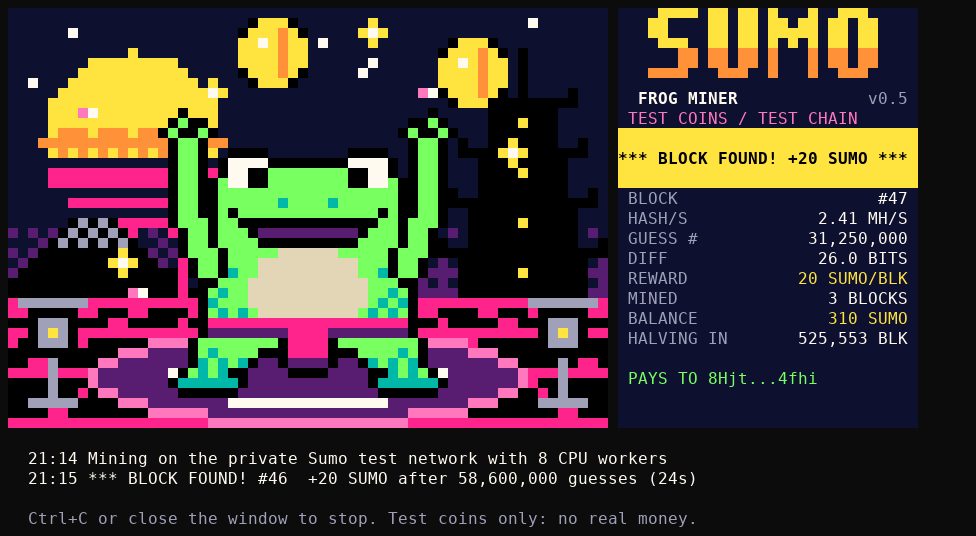
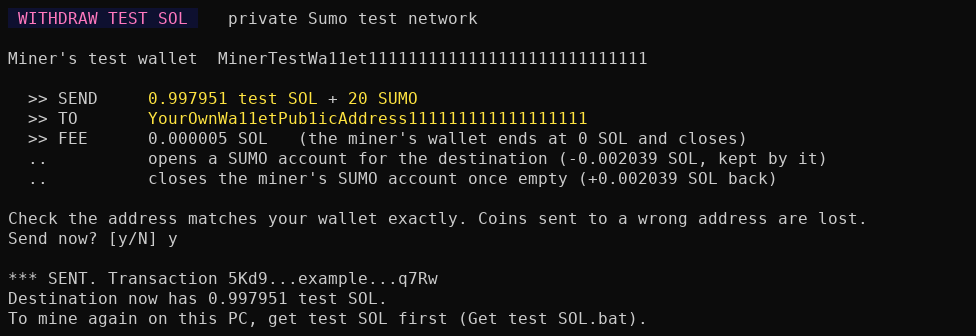

# HOW TO MINE SUMO FROG ($SUMO)

*A short guide for friends trying the test miner on Windows.*

> **This is a TEST chain on Solana's public devnet.** Test SUMO has no value, can't be bought or sold, and may be reset. This is not an investment. It's a hobby project for trying out mining.

## What you need

- A Windows PC with an internet connection.
- **Python.** The miner runs on Python. If it's missing, the miner tells you, and you install it once (see step 1).
- About 5 minutes. The first run sets itself up, which takes about a minute.

## 1. Install Python (only if you don't have it)

1. Go to **python.org/downloads** and click the big yellow **Download Python** button.
2. Run the installer. On the first screen, **tick "Add python.exe to PATH"**, then click **Install Now**.

Not sure if you have it? Skip this step. If Python is missing, the miner says "Python isn't installed yet" and you can come back here.

## 2. Download and unzip the miner

1. Download the miner: **[sumo-miner-v0.6.4-devnet.zip](downloads/sumo-miner-v0.6.4-devnet.zip)**. Check the file: SHA-256 `b8d98d564385cd73793f749128509ec6b2a96fe0c3f9fe292c406038a3938817`.
2. Right-click the zip and choose **Extract All…**, then click **Extract**.
3. Open the new folder. You'll see **SUMO Frog.bat** and **START HERE.txt** on top, and a **files** folder with everything else. There is nothing to edit: this zip is already set to public Solana devnet.

   Updating from an older miner? Extract into the **same** folder and choose **Replace the files**. Your wallet file `sumo-devnet-key.json` is not in the zip, so it stays as it is. The first time you run SUMO Frog.bat it moves that wallet into the new **files** folder. **Never delete** `sumo-devnet-key.json`, wherever it is: it holds your test SUMO. If the miner says "Two wallets found", it has stopped on purpose: read what it says and don't delete anything. Delete the five old buttons next to SUMO Frog.bat if they're still there (**Mine SUMO.bat**, **Check balance.bat**, **Get test SOL.bat**, **Set payout address.bat** and **Withdraw SOL.bat**) and the old **HOW TO MINE.txt** next to SUMO Frog.bat. The old Mine SUMO.bat can make a second wallet. Delete only those files, never the wallet.

## 3. Double-click "SUMO Frog"

1. Double-click **SUMO Frog.bat**. A menu appears: **1 Mine SUMO**, **2 Check balance**, **3 Set payout address**, **4 Withdraw SOL**, **5 Exit**.
2. If Windows says **"Windows protected your PC"**, click **More info**, then **Run anyway**. It's a plain text script; you can right-click it and choose **Edit** to see exactly what it does.
3. Press **1**. The first time, it sets itself up for about a minute, makes your test wallet and shows its address, then says it needs test SOL. That's normal.
4. Get free test SOL: open **[https://faucet.solana.com](https://faucet.solana.com)**, sign in with GitHub, pick **Devnet**, paste the wallet address from step 3 (or press **2** in the menu, Check balance, to see it again), and request the most it allows.
5. Double-click **SUMO Frog.bat** again and press **1**. Mining starts. Leave the window open.

While it works, the box on the right says **>> MINING...**. When you win a block, it turns into **\*\*\* BLOCK FOUND! +20 SUMO \*\*\*** and the frog throws its arms up.

Your computer's fans may speed up. That's normal, because mining uses all of your processor.

**What the numbers mean**

| Label | Meaning |
|---|---|
| BLOCK | the block everyone is racing for right now |
| HASH/S | how many guesses your PC makes per second |
| GUESS # | how many guesses it has made on this block so far |
| DIFF | how hard a block is (each +1 doubles the work) |
| REWARD | SUMO for winning a block: 20 now, halving once a year |
| MINED | blocks you've won since you opened the window |
| BALANCE | SUMO in the wallet your rewards go to |
| HALVING IN | blocks left until the reward halves |

If the window is narrow, the miner hides the frog picture and just shows the numbers. Make the window wider (about 100 columns) to see the frog.

## 4. Send rewards to your own wallet (optional)

By default, rewards stay in the miner's own test wallet. To send them to a wallet you already use:

1. In the menu, press **3** (Set payout address).
2. Paste your wallet's **public address** (the one you'd share to receive coins) and press Enter.
3. Check the address it shows you, then type **YES**.

From then on, each reward goes to that wallet. The miner's own test wallet still pays the tiny network fees.

Advanced: you can also start the miner with `sumo_miner.py mine --payout YOUR_PUBLIC_ADDRESS`.

**Only ever paste a public address.** Never type a seed phrase or private key into the miner or anywhere else. The miner refuses them, and nothing here will ever ask for one.

## 5. Check your balance

In the menu, press **2** (Check balance) at any time. It shows your test SUMO (and your payout address's SUMO, if you set one), your test SOL and the network stats (blocks mined, difficulty, reward, supply).

## 6. Stop mining

Press **Ctrl+C**. The miner asks "Stop mining?": press **Y** to stop and go back to the menu, or **N** to keep mining. Closing the window also stops it. If Windows asks "Terminate batch job (Y/N)?" instead (this can happen between blocks, or before the miner is hashing), mining has already stopped: **N** goes back to the menu, **Y** closes. After anything except mining, the menu comes back. Your coins stay in your wallet.

## 7. Take your test SOL back out (optional)

When you've finished mining on a PC, you can send the miner's leftover test SOL to your own wallet:

1. In the menu, press **4** (Withdraw SOL).
2. Paste your wallet's **public address**, or just press Enter to use your payout address (it shows it and asks you to confirm).
3. It shows how much test SOL it will send, where to, and the fee. Type **y** to send, or press Enter to cancel.

It sends everything minus the tiny fee, so the miner's wallet ends at 0 and closes cleanly. If the miner's wallet also holds SUMO (because you mined without a payout address), it asks whether to send that too. It refuses seed phrases, private keys, program addresses and the miner's own address. To mine again afterwards, get test SOL first from **https://faucet.solana.com**.

Advanced: `sumo_miner.py withdraw YOUR_PUBLIC_ADDRESS --sumo --yes` sends SOL and SUMO without asking.

## Your wallet file: keep it private

- The miner makes its own wallet file called **`sumo-devnet-key.json`** in the **files** folder. It's made for you the first time you run SUMO Frog.
- **You never type a seed phrase or private key.** Nothing in this guide or the miner will ever ask for one. If anything does, it isn't us, so don't do it.
- **Don't share that file or send it to anyone.** Whoever has it controls the test coins in it.
- **Don't delete it.** It holds your test SUMO. If you download a newer miner later, unzip it over the same folder and the wallet file stays put.
- It's a test-only wallet. Don't use it for anything else, and don't send real coins to it.

## If something goes wrong

- **"needs a little test SOL for fees"**: get free devnet SOL at **https://faucet.solana.com** (sign in with GitHub, pick Devnet, paste your miner wallet address), then start mining again.
- **"Python isn't installed yet"**: do step 1, then double-click **SUMO Frog.bat** again.
- **"Install failed"**: check your internet connection and try again.
- **"Another miner got there first"**: that's normal. Someone else won that block, and the miner moves on to the next one by itself.
- **Strange symbols instead of colours**: your console is very old. Run the miner in plain mode: open a Command Prompt in the **files** folder and run `.venv\Scripts\python.exe sumo_miner.py mine --plain`.

## How it works, in one paragraph

Your computer makes millions of guesses (guess #1, guess #2, ...), looking for a hash that beats the current difficulty. The first miner to find one wins the block and gets the block reward of test SUMO: 20 SUMO now, halving once a year, and never more than 21 million in total. There's no premine and no team share: every SUMO comes from mining. The difficulty adjusts so blocks keep coming at a steady pace however many people are mining.
